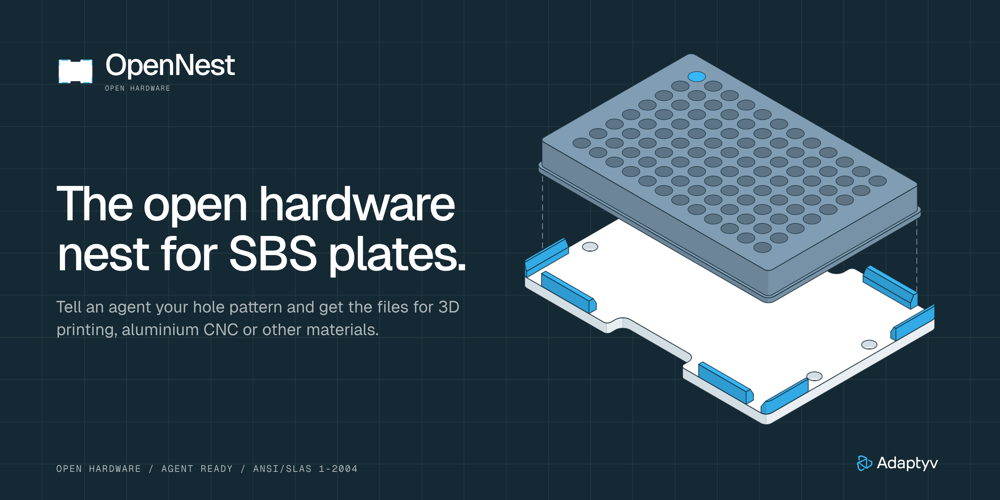

# Adaptyv OpenNest

An open hardware deck plate that holds an SBS microplate where a robot can find it. The pocket,
tabs and notches are fixed. The holes are yours: tell an agent your pattern and a script builds
the files for 3D printing, aluminium CNC or other materials.

**Status: work in progress, internal only.** The agent script and release models are still being
built. A v1.3 plate has been printed. This v1.4 geometry has not yet been printed, machined or run
on a robot.

- [Design and manufacturing guide (PDF)](docs/OpenNest-Guide.pdf)
- [Design source and brand assets](design/)
