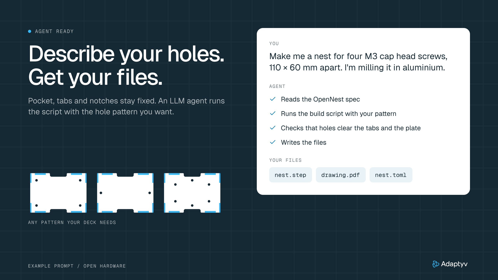
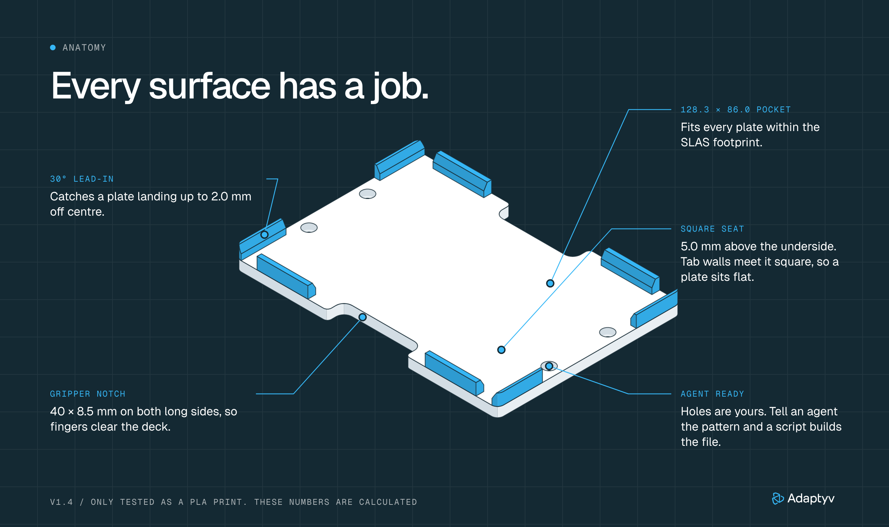
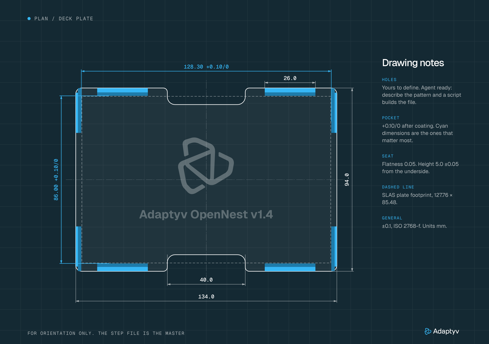
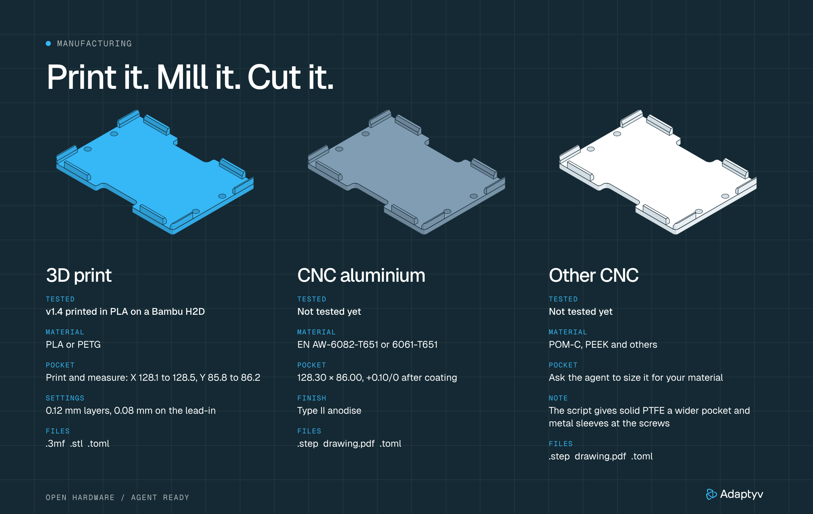

<p align="center"></p>

# Adaptyv OpenNest

An open hardware deck plate that holds an SBS microplate where a robot can find it. The pocket, tabs
and notches are fixed. The holes are yours: tell an agent your pattern and a script builds the files
for 3D printing, aluminium CNC or other materials.

**[Design and manufacturing guide (PDF)](docs/OpenNest-Guide.pdf)**

## What has been tested

| v1.4 | Status |
| --- | --- |
| 3D print in PLA on a Bambu H2D | **Printed.** No measurements recorded yet |
| 3D print in other materials | Not tested |
| CNC aluminium | Not tested |
| CNC POM-C or PEEK | Not tested |
| CNC solid PTFE | Not tested |
| On a robot | Not tested |

That is the whole list. Every other number here is calculated from the model and the SLAS standard.

## Agent ready

Open this repo in your coding agent and describe what you need:

> Make me an OpenNest with four M3 cap head screws, 110 x 60 mm apart. I'm milling it in aluminium.

The agent reads [AGENTS.md](AGENTS.md), runs the script and checks the result. You can run it yourself
too, with [uv](https://docs.astral.sh/uv/) installed:

```sh
uv run cad/nest.py check --material 6082 --screw M3 --head cap --spacing 110x60
uv run cad/nest.py make  --material 6082 --screw M3 --head cap --spacing 110x60 --name deck-a --label "Slot A3"
```

`check` needs no CAD and explains anything that will not work. `make` takes about 20 s and writes to
`out/deck-a/`. `--label` is free text engraved under the title and version: a slot name, or anything
you want to read on the part.

| File | What it is |
| --- | --- |
| `nest.step` | The part. This is the file for a CNC shop |
| `nest.stl` | The same part as a mesh |
| `nest.toml` | The design record: version, commit, your inputs and every dimension |
| `nest.3mf` | 3D printing only. For PLA, a Bambu Studio project for the H2D with tuned settings |
| `drawing.pdf` | CNC only. A one-page shop drawing with your hole table |
| `report.json` | What was built, what was checked, the fit table, and what could not be checked |

<p align="center"></p>

### Find the dimensions later

Keep `nest.toml` with the part. It holds everything needed to read a dimension or build the same part
again:

```sh
uv run cad/nest.py make --config out/deck-a/nest.toml
```

If only the plate survives, read the version engraved on it and open
[`docs/versions/`](docs/versions/), which holds every fixed dimension of each version.

## The plate

<p align="center"></p>

| | |
| --- | --- |
| Envelope | 134 x 94 x 11 mm |
| Pocket | 128.3 x 86.0 mm, +0.10/0 |
| Seat | 5.0 mm above the underside |
| Lead-in | 30 degrees from vertical, starting 3 mm above the seat |
| Catch | About 2.0 mm per side for a nominal plate |
| Gripper notches | 40 x 8.5 mm, on both long sides |

By calculation, every plate within ANSI SLAS 1-2004 fits at 20 C, with 0.02 mm to spare at the limit
of the standard. Plastic plates grow faster than aluminium, so at 37 C a plate at the +-0.5 mm limit
is 0.06 mm too big in X and 0.05 mm in Y, while one within +-0.25 mm still clears by about 0.2 mm.
`report.json` has the table for your material. The numbers are in [the guide](docs/OpenNest-Guide.pdf), along with the drawing, the tolerances and
an acceptance check.

<p align="center"></p>

## Materials

<p align="center"></p>

| `--material` | Process | Pocket, mm | Tested | Notes |
| --- | --- | --- | --- | --- |
| `pla` | 3D print | 128.3 x 86.0 | Printed on a Bambu H2D | Bambu H2D project. Measure the pocket and correct shrink with `--xy-scale` |
| `petg`, `asa` | 3D print | 128.3 x 86.0 | No | Plain 3MF, so set up your own slicer profile |
| `6082`, `6061` | CNC aluminium | 128.3 x 86.0 | No | Type II anodise |
| `peek` | CNC polymer | 128.3 x 86.0 | No | Keep screw torque low |
| `pom-c` | CNC polymer | 128.4 x 86.1 | No | Keep screw torque low |
| `ptfe` | CNC PTFE | 129.0 x 86.5 | No | Changes size at room temperature, so 96-well plates only, on metal sleeves |

The pocket grows when the material would otherwise close on the largest SLAS plate at 15 C. The
expansion figures behind that are typical handbook values, not measurements.

Reference plates with no holes are in [`models/`](models/). Each folder has a `report.json`.

## Status

**Work in progress, and internal for now.** The test status is at [the top of this page](#what-has-been-tested).

`cad/nest.py` checks that a file matches its plan: it probes the finished STEP for the pocket walls,
the seat, the lead-ins, the notches and every hole. These are software checks, not part tests. They
cannot show that your holes match your deck, so measure before you cut.

The printed plate came from the build scripts that came before this one. For blank and cap head
plates, the script's output matches those files at all 2,500 random probe points we compared.

The most useful contribution is a [fit report](.github/ISSUE_TEMPLATE/fit-report.yml) from a plate you
made. See [CONTRIBUTING.md](CONTRIBUTING.md).

## License

Hardware design: [CERN-OHL-P-2.0](LICENSES/CERN-OHL-P-2.0.txt). Documentation and figures:
[CC-BY-4.0](LICENSES/CC-BY-4.0.txt). Tests and tooling: [MIT](LICENSES/MIT.txt). Details are in
[LICENSE](LICENSE). The Adaptyv name and logo are not licensed: see [TRADEMARKS.md](TRADEMARKS.md).
